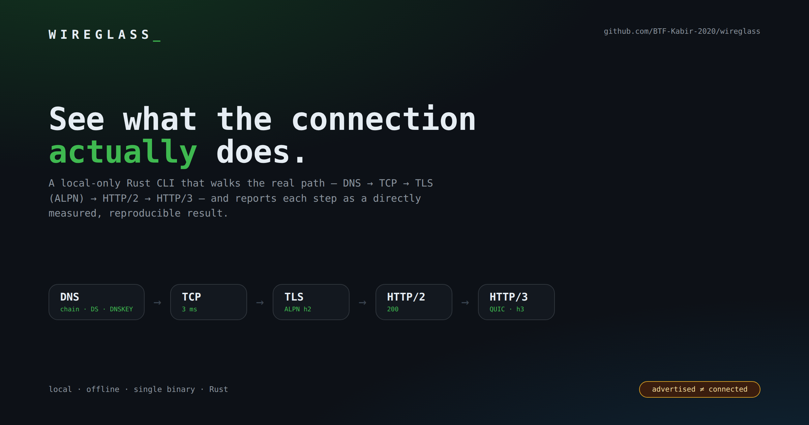
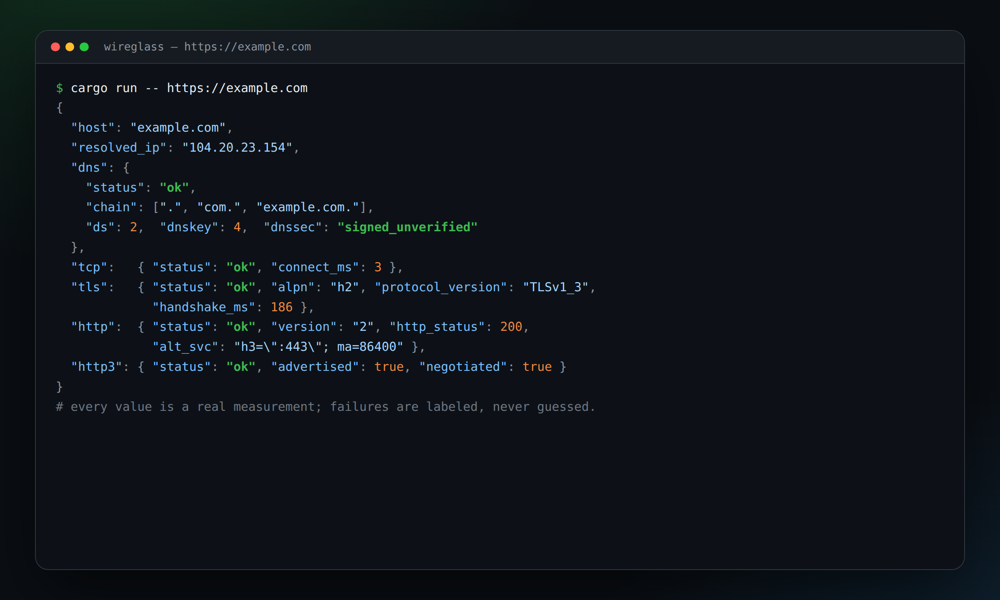

# WIREGLASS

[](https://github.com/BTF-Kabir-2020/wireglass/actions/workflows/ci.yml)
[](#license)

Project page: https://ghourchiani.ir/projects/wireglass

> **See what the connection actually does.**
> A local-only Rust CLI that measures DNS → TCP → TLS (ALPN) → HTTP/2 → HTTP/3, with separate, protocol-aware UDP connectivity diagnostics for STUN and QUIC.



Status: **Phase 1 — scoring + interpretive roast on top of the Phase 0 measurement engine.** Report, score, and honest failures are all in one JSON. See `docs/evidence-plan.md`.

## What it actually measures

One command, one report:

- **DNS** — A / AAAA records with real TTLs, CAA records, the NS/SOA **delegation chain** (root → … → host zone), raw **DS / DNSKEY** records, and explicit errors (via `hickory-resolver`).
- **TCP** — real connect timing to a chosen address.
- **TLS** — real handshake timing, negotiated protocol version, cipher suite, **negotiated ALPN**, and certificate subject/issuer/expiry (via `rustls` + `x509-parser`).
- **HTTP/2** — a real request over the negotiated ALPN, capturing status, `server`, and `Alt-Svc`.
- **HTTP/3** — a **real QUIC handshake** with ALPN `h3`. The report distinguishes *advertised* (`Alt-Svc`) from *actually connected*. A protocol being advertised is never reported as working.
- **UDP/STUN** — a STUN Binding request with response type, magic cookie, transaction ID, message/attribute length validation, timeout, and repeat measurements.
- **UDP/QUIC** — optional probes reuse the HTTP/3 QUIC handshake implementation and accept independently configurable host/port targets.

Every failed measurement is reported with its error and a precise status. A UDP timeout means only that no valid response was observed from that tested endpoint during the timeout; it does not prove UDP is blocked. DNS and TCP outcomes are recorded separately and never stand in for UDP evidence.

## Why it is different

Per `docs/competitors.md`, "a timeline" and "a reproducible report" alone are **not** unique — `http-stat-rs` and `httptap` already cover that. WIREGLASS bets on the combination:

1. Deep DNS + TLS + HTTP/2 + HTTP/3 in one reproducible output.
2. Honest reporting of the **silent HTTP/3 downgrade** (advertised vs. actually connected).
3. Protocol-aware STUN and QUIC measurements with structured failure categories.
4. Local, offline, single-binary Rust — no third-party service sees your data.

## Run it

```sh
cargo run -- https://example.com
cargo run -- https://example.com --compact
cargo run -- https://example.com --timeout 15
cargo run -- https://example.com --card card.svg evidence/example-com

# Probe one or more STUN endpoints (repeat --stun-target for multiple targets)
cargo run -- --stun-target stun.l.google.com:19302 --timeout 3 --repeat 3

# Probe multiple QUIC/HTTP-3 targets (repeat --quic-target as needed)
cargo run -- --quic-target example.com:443 --quic-target example.net:8443 --timeout 5 --repeat 2

# Include one UDP diagnostic alongside the normal URL report
cargo run -- https://example.com --stun-target stun.l.google.com:19302
```

### Docker

```sh
docker build -t wireglass .
docker run --rm wireglass https://example.com
```

Output is JSON on stdout (pretty by default). UDP-only invocations emit a `UdpReport` with a `udp_measurements` array; combining UDP options with a URL adds that array to the existing report while retaining all current report fields. Each measurement includes `target`, `resolved_ip`, `transport`, `port`, `elapsed_ms`, `attempts`, `successes`, `status` (`success`, `timeout`, `protocol_error`, or `resolution_error`), `failure_category` (`null` on success, otherwise the same category), and an optional error description. STUN success requires a valid correlated Binding response; QUIC success requires the reused `h3` handshake to complete.

Bracket IPv6 literals when providing a port, e.g. `--stun-target '[2001:db8::1]:3478'`.

### Verify the QUIC/HTTP-3 client path

Network may block outbound UDP/443, which makes real HTTP/3 hosts time out. To prove the client itself works, run the loopback self-check:

```sh
cargo run --example quic_selfcheck
```

Expected:

```
[client] QUIC handshake OK, negotiated alpn=Some("h3")
[server] accepted QUIC connection, alpn=Some("h3")
```

## Example report (trimmed)

```json
{
  "host": "example.com",
  "resolved_ip": "104.20.23.154",
  "dns":   { "status": "ok", "a": ["104.20.23.154"], "aaaa": ["2606:4700:10::6814:179a"], "min_ttl_secs": 159,
             "chain": [".", "com.", "example.com."], "dnssec": "signed_unverified" },
  "tcp":   { "status": "ok", "connect_ms": 2 },
  "tls":   { "status": "ok", "alpn": "h2", "protocol_version": "TLSv1_3", "cert_not_after": "2026-12-25T22:56:35Z" },
  "http":  { "status": "ok", "version": "2", "http_status": 200, "alt_svc": "h3=\":443\"; ma=86400" },
  "http3": { "status": "ok", "advertised": true, "negotiated": false, "fallback_used": true,
             "note": "Alt-Svc advertised h3 but QUIC handshake failed: ..." }
}
```



## UDP example (trimmed)

```json
{
  "tool": "wireglass",
  "version": "0.1.0",
  "ran_at_utc": "2026-10-28T00:00:00Z",
  "udp_measurements": [
    {
      "target": "stun.example.net:3478",
      "resolved_ip": "192.0.2.10",
      "transport": "udp/stun-binding",
      "port": 3478,
      "elapsed_ms": 84,
      "attempts": 3,
      "successes": 3,
      "status": "success",
      "failure_category": null
    },
    {
      "target": "stun.example.net:3479",
      "resolved_ip": "192.0.2.10",
      "transport": "udp/stun-binding",
      "port": 3479,
      "elapsed_ms": 3002,
      "attempts": 3,
      "successes": 0,
      "status": "timeout",
      "failure_category": "timeout",
      "error": "no valid STUN response within 1s (3/3 attempts)"
    }
  ]
}
```

A successful UDP probe is scoped to the tested endpoint/protocol/port. It is not evidence that other UDP ports, other hosts, or all traffic from the same network are reachable.

## Interpreting UDP results

Results describe only the configured endpoint, resolved address, protocol, port, and network path at the time of measurement. They are not proof of nationwide filtering status or of reachability to other hosts, ports, or UDP protocols. `timeout` specifically means no valid response arrived before the configured timeout; it is not classified as a protocol error and must not be read as proof that UDP is blocked. A DNS lookup or TCP connection succeeds independently and says nothing about arbitrary UDP reachability.

## Honest limitations (current skeleton)

- **DNSSEC validation:** the delegation chain and raw `DS` / `DNSKEY` records are reported, but signatures are **not cryptographically validated**. `dnssec` is one of `unsigned`, `signed_unverified`, or `delegation_signed_no_dnskey` (the last means a parent `DS` existed but the resolver returned no `DNSKEY`). Full chain-of-trust verification is not implemented.
- **HTTP/3 request/response:** only the QUIC handshake is implemented. The report says so explicitly instead of pretending.
- **UDP/STUN authentication:** the response type, magic cookie, transaction ID, declared length, and attribute bounds are validated, but `MESSAGE-INTEGRITY` / `FINGERPRINT` are not. Authenticated STUN and TURN allocations are out of scope.
- **One address per target:** UDP probes resolve the target once and test the preferred address (IPv4 first). They do not retry other A/AAAA answers, so a timeout on one address is not evidence about the others.
- **No inference from other stages:** DNS, TCP, TLS, and HTTP outcomes are measured independently and never used to claim arbitrary UDP reachability. A timeout is a timeout, not a verdict on filtering.
- **Single vantage point:** results describe this host, this resolver answer, this endpoint, and this moment. They do not prove nationwide filtering status.
- **IPv4 preferred** for the connection step; IPv6-only hosts still resolve but are not connected to.

## Project layout

```
src/
  main.rs    # CLI (clap) + orchestration
  model.rs   # report types (serde)
  dns.rs     # DNS collectors
  net.rs     # TCP connect
  tls.rs     # TLS handshake, ALPN, certificate info
  http.rs    # HTTP/2 (h2) and HTTP/1.1 request
  h3.rs      # QUIC/HTTP-3 handshake probe
  udp.rs     # STUN Binding + QUIC UDP diagnostics
examples/
  quic_selfcheck.rs   # loopback proof that the QUIC client works
docs/
  competitors.md      # competitor research
  evidence-plan.md    # competitors turned into acceptance tests
```

Raw run logs/JSON are kept in a local `evidence/` folder (git-ignored) — they are
reproducible on demand rather than committed.

## Tests

```sh
cargo test
cargo run --example quic_selfcheck
```

## Contributing

Contributions are welcome. Please read [CONTRIBUTING.md](CONTRIBUTING.md) and the
[Code of Conduct](CODE_OF_CONDUCT.md). Before opening a pull request, run
`cargo fmt --all`, `cargo clippy --all-targets -- -D warnings`, and `cargo test`.

- Questions and usage help: [SUPPORT.md](SUPPORT.md).
- Security reports: [SECURITY.md](SECURITY.md) (privately, not as a public issue).
- How decisions are made: [GOVERNANCE.md](GOVERNANCE.md).

## Status

Early skeleton. UDP diagnostics are implemented and covered by deterministic
local tests, but the Phase 1 evidence gate in `docs/evidence-plan.md` (G1–G6) is
still open. No release tag or public claim is made until that evidence is
recorded. UDP results are measurements of a tested endpoint, not a conclusion
about nationwide filtering.

## License

Licensed under either of:

- MIT license ([LICENSE-MIT](LICENSE-MIT))
- Apache License, Version 2.0 ([LICENSE-APACHE](LICENSE-APACHE))

at your option.

Unless you explicitly state otherwise, any contribution intentionally submitted
for inclusion in this project by you, as defined in the Apache-2.0 license, shall
be dual licensed as above, without any additional terms or conditions.
